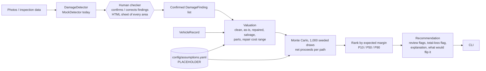

# UnderScope

A decision engine for damaged vehicles. Given damage findings (eventually from ACV inspection
images) plus vehicle data, it estimates net proceeds for each disposition path and recommends
the one with the highest expected margin:

1. Repair, then sell on ACV Auctions
2. Sell as-is on ACV Auctions
3. Sell as salvage on Copart
4. Part out the vehicle

It serves two personas: the **dealer** ("does a $600 dent repair pay back on ACV?") and the
**insurance adjuster** ("total it and send it to Copart, or not?").

**Status:** development prototype. Every number comes from `config/assumptions.yaml`, all
labeled PLACEHOLDER and deliberately untuned. The ACV and Copart adapters are stubs, and nothing
calls the network. Fixtures and synthetic data are clearly labeled. Nothing here is real market data.

This README explains the implementation: what each stage does, the formulas it uses, and why
it is built that way. `PROGRESS.md` holds the review log and open decisions.

## Setup

```bash
python3 -m venv .venv
.venv/bin/pip install -e '.[dev]'
make test   # pytest -q
make lint   # ruff
```

## Quick start

A human checker confirms the damage findings before any decision is made. By default every
vehicle goes to the checker.

```bash
# At a terminal: shows every area of the car, writes reviews/<VIN>.html, then prompts.
.venv/bin/underscope evaluate data/fixtures/dent_600.json

# Agent / batch handoff: writes reviews/<VIN>.json + .html and exits with code 3.
.venv/bin/underscope evaluate data/fixtures/total_loss.json --no-interactive
.venv/bin/underscope confirm reviews/FIXTOTAL000000001.json --checker NAME \
    [--add frame:dent:0.6] [--remove 2] [--undercarriage yes|no] [--engine-audio yes|no]
.venv/bin/underscope evaluate data/fixtures/total_loss.json --confirmed reviews/FIXTOTAL000000001.json

# Many vehicles: decide the confirmed ones, queue the rest (exit 3 while any are waiting).
.venv/bin/underscope batch data/fixtures --out decisions.jsonl
.venv/bin/underscope queue          # list reviews, pending first; writes reviews/index.html

# Variants
.venv/bin/underscope evaluate data/fixtures/dent_600.json --review-mode risky      # only risky cars
.venv/bin/underscope evaluate data/fixtures/total_loss.json --json --skip-confirm  # batch/testing
.venv/bin/underscope evaluate vehicle.json --labels labels.json   # MockDetector labels per photo

# Evaluation reports (synthetic)
.venv/bin/python -m underscope.data          # regenerate data/synthetic/ (500 vehicles, seed 7)
.venv/bin/python -m underscope.backtest      # -> reports/backtest.md
.venv/bin/python -m underscope.sensitivity   # -> reports/sensitivity.md
.venv/bin/python -m underscope.case_studies  # -> reports/case_studies.md
```

## Architecture



| Module | Responsibility |
|---|---|
| `models.py` | Pydantic domain model: `VehicleRecord`, `DamageFinding`, `DispositionOption`, `Recommendation`, enums for panels, damage types, title status and paths |
| `perception.py` | `DamageDetector` protocol and `MockDetector`, which reads labels from fixtures instead of pixels |
| `review.py` | Human-in-the-loop review: risk signals, the area checklist, the review request JSON, checker edits, the HTML sheet |
| `config.py` | Loads and schema-checks `config/assumptions.yaml` |
| `valuation.py` | Damage + vehicle to values and repair-cost ranges (integer cents) |
| `decision.py` | Monte Carlo simulation of each path, ranking, review flags, flip conditions, explanation |
| `cli.py` | `underscope evaluate` (with the review gate), `confirm`, `queue` and `batch` |
| `data.py` | Fixture source, ACV/Copart stubs, synthetic generator, perturbed "true world" |
| `backtest.py`, `sensitivity.py`, `case_studies.py` | Evaluation reports in `reports/` |

## 1. Inputs and domain model (`models.py`)

Vehicle JSON fields:

| Field | Meaning |
|---|---|
| `vin, year, make, model, trim, mileage, region` | Identity and market; `region` selects the total-loss threshold |
| `title_status` | `clean`, `salvage` or `rebuilt` |
| `photo_refs` | Photo names; the detector maps them to findings |
| `undercarriage_damage`, `engine_audio_abnormal` | Inspection flags: `true`, `false`, or missing (`null` = not inspected) |
| `insurance_claim` | `true` for the adjuster persona. Only then can repair cost past the total-loss threshold brand the title |
| `clean_value_cents` | Optional market anchor; otherwise a placeholder depreciation curve is used |
| `findings` | Optional inline findings |

A `DamageFinding` has `panel`, `damage_type` (scratch, dent, crack, crush, broken), `severity`
(0-1), `confidence` (0-1, read as the probability the damage exists), an optional `photo_ref`,
and `verified` (set once a human checker confirms or adds it).

Panels: front bumper, rear bumper, hood, fender, door, quarter panel, roof, windshield, frame.
Panels have no left/right side in the model.

## 2. Perception (`perception.py`)

`DamageDetector` is a protocol: `detect(vehicle) -> list[DamageFinding]`. Today the only
implementation is `MockDetector`. It returns the vehicle's inline findings plus any labels
supplied per photo (`--labels`), tagging each with its `photo_ref`. A real image model would
plug in behind the same protocol.

## 3. Human checker (`review.py`, `cli.py`)

A detector can't flag damage it never saw. In the synthetic backtest, one missed frame finding
alone cost about $3,700. So by default a person confirms the findings before the engine decides.

**When it asks.** `--review-mode all` (default) asks for every vehicle. `--review-mode risky`
asks only when a risk signal exists:

- a finding below the low-confidence threshold (`simulation.low_confidence_threshold`)
- a missing undercarriage or engine-audio inspection
- undercarriage damage flagged, or frame damage detected
- no damage detected at all
- the engine itself flags the decision (close call or threshold-decided, see section 5)

These reuse existing thresholds; the review step adds no new numbers.

**What the checker sees.** Every area of the car (the 9 panels plus undercarriage and engine)
marked as one of:

- **damaged**: a finding or a positive inspection flag
- **verify**: a high-risk area nothing confirms either way (frame with no finding, a missing
  inspection)
- **clear**: nothing detected

The terminal shows this checklist. `reviews/<VIN>.html` shows a top-down car diagram with every
damaged area colored by severity (minor below 0.33, moderate to 0.66, severe above), verify areas
outlined with dashes, the findings table with photo refs, and the reasons for review.

**How the checker answers.**

- *Interactive* (default when a terminal is attached): `a` accept, `+ panel type severity` add,
  `- N` remove, `s N severity` re-score, `u yes|no` and `e yes|no` set the inspection flags,
  `q` quit and leave it pending. After `a` and a checker name, the decision runs.
- *File handoff* (`--no-interactive`, for agents and batch): the CLI writes the request JSON and
  HTML and exits with code 3 (awaiting confirmation). The admin runs `underscope confirm` with
  any edits, then `underscope evaluate ... --confirmed <file>` makes the decision. Resuming
  refuses a review that is still pending or belongs to a different VIN.

Confirming marks every finding `verified` with confidence 1.0 and records the checker and time.
The output says who confirmed the findings. `--skip-confirm` bypasses the gate and the output
says the findings were not confirmed.

**Many vehicles.** `underscope batch DIR` goes through a folder of vehicle files. A vehicle with
a confirmed review is decided; one without gets a pending review (an in-progress review is kept,
not overwritten). It prints one line per vehicle, can write the decisions as JSONL (`--out`),
and exits 3 while any vehicle is waiting. `underscope queue` lists every review, pending first,
and writes `reviews/index.html`, a page linking each car's sheet with its damaged and
to-verify areas.

## 4. Valuation (`valuation.py`)

All money is integer cents. Ranges are `[low, expected, high]`.

- **Clean value:** `clean_value_cents` if given; otherwise
  `new_value × (1 - depreciation)^age - cents_per_mile × mileage`, floored.
- **Repair cost:** sum over findings of
  `panel_base[panel] × type_multiplier[type] × (min_sev + (1 - min_sev) × severity)`.
  The low and expected values are scaled by confidence (a finding that may not exist costs
  less in expectation). The high value is not, so the downside tail stays.
- **Damage score:** `min(1, expected repair cost / clean value)`. It drives several values below.
- **Repaired value:** `clean × (1 - haircut_at_total_damage × damage_score)`. The
  accident-history haircut scales with damage, so a cosmetic fix carries little stigma and
  heavy damage the full placeholder (20%).
- **Salvage value:** `clean × salvage_fraction × (1 - adjust × damage_score)`.
- **As-is value:** `clean - discount_multiple × expected repair cost` (buyers mark down visible
  damage), floored at a fraction of clean, times the current title factor, and never below
  expected salvage value (a buyer can always salvage the car).
- **Parts value:** `clean × gross_fraction × (1 - parts lost to damage)`, less a penalty if the
  engine audio is abnormal. Each damaged panel loses up to its share of total parts value, by
  damage type and severity.
- **Title after repair:** salvage or rebuilt becomes rebuilt. A clean title is branded only on
  an insurance claim whose repair ratio reaches the region's total-loss threshold.

## 5. Decision (`decision.py`)

**Simulation.** 1,000 seeded draws. Every random input is drawn up front in a fixed order, so all
paths share the same market shock in each draw (common random numbers). Comparisons between
paths are therefore paired, and results are reproducible.

| Input | Distribution |
|---|---|
| Market shock | lognormal, sigma `value_noise_sigma` |
| Repair cost, salvage, parts gross, sell-through, teardown, transport, days | triangular over `[low, expected, high]` |
| Title factors | triangular per status, all driven by one shared uniform so clean, rebuilt and salvage move together |

**Net proceeds per path** (each draw, integer cents):

- **Repair then ACV:** `repaired value × shock × title factor - repair - ACV fee - transport
  - holding × (repair days + days to sell) - hidden-damage reserve`. The reserve is a % of repair
  plus extras for flagged or missing inspections. On a clean-title insurance claim, a draw whose
  repair cost crosses the threshold is branded.
- **As-is on ACV:** `as-is value × shock × (title draw / expected title factor) - ACV fee
  - transport - holding × days`. In a draw where the insurer totals the car, the buyer gets a
  salvage certificate, so the salvage title factor applies. The as-is sale never falls below
  the salvage sale in the same draw (a buyer can always salvage the car).
- **Salvage on Copart:** `salvage × shock - Copart fee - transport - holding × days`.
- **Part out:** `parts gross × shock × sell-through - teardown - storage × days - tow`.

Fees are a flat amount plus a % of the sale price. Every path's components (sale price, fees,
transport, holding, ...) are kept, and they sum exactly to the net in every draw.

**Ranking.** Paths are ranked by expected net. P10, P50 and P90 come from the same draws.

**Persona answer.** Each recommendation opens with a direct answer to the persona's question:

- *Dealer* (no claim): "Repair pays back" or "Repair does not pay back", with the average
  difference between repairing and selling as-is and the share of draws where repair is ahead.
- *Adjuster* (insurance claim): "Total loss" when repair crosses the regional threshold in at
  least 80% of draws, "Not a total loss" below 20%, otherwise "Borderline total loss" (a firm
  repair estimate settles it). The expected repair ratio and threshold are stated either way.

**Review flags** (`needs_human_review`), any of:

- another path beats the winner in at least 35% of draws (`review_overlap_threshold`). Every
  rival counts, not only the runner-up, because the real threat is sometimes the third path.
- mean finding confidence below 0.60
- the total-loss threshold decides the outcome: at least 5% of draws cross it
  (`total_loss_min_branded_share`), and the winner differs between "repaired title stays
  clean" and "repaired title is branded"

**What would flip it.** Repair cost moves several paths at once (repair net, as-is price, title
brand), so the repair-cost flip point is found by bisection: re-run valuation and simulation
with the repair estimate scaled between 0x and 3x and find where the winner changes. Price levers
that move a single path (as-is or salvage sale price, net parts revenue) use an exact closed form.

**Explanation.** Plain English: the winner and its range, the gap to the next path and how
often that path wins, repair cost against clean value and the threshold, branding share, and
both counterfactual winners when the threshold decides.

## 6. Assumptions (`config/assumptions.yaml`, `config.py`)

Every number is a PLACEHOLDER with a `replace_with` note naming the real data that should
replace it. The sections are base value, repair cost, market, fees, transport, timing, title,
total loss, parts, hidden damage and simulation. On load, `config.py` rejects:

- a section that isn't labeled PLACEHOLDER or lacks a `replace_with` note
- an unordered `[low, expected, high]` range
- a percent outside 0-100, or negative cents
- a missing panel, damage type, path or title status in an enum-keyed table
- non-positive draws

It reports every problem at once.

## 7. Evaluation (`data.py`, `backtest.py`, `sensitivity.py`, `case_studies.py`)

- **Synthetic data:** 500 vehicles (seed 7) with true findings and noisy perceived findings
  (severity noise, 5% missed, imperfect confidence). Each vehicle has one realized net per path.
- **Two truths:** `vehicles.jsonl` draws outcomes from the engine's own model, which is circular
  and only measures noise. `vehicles_misspecified.jsonl` draws them from `perturbed()`: every
  placeholder (each range as a unit) is scaled by a seeded factor within ±25%, and market noise
  is 1.5x wider. The gap between the two shows how much the results lean on the engine's own
  assumptions.
- **Backtest:** accuracy against the oracle, average regret (oracle net minus chosen net), and
  review rate, compared with "always pick one path". It is broken down by damage band (light
  below 15% repair ratio, mid 15-50%, heavy) and by review flag, including a comparison on just
  the unflagged cars.
- **Sensitivity:** scales each key placeholder from 0.5x to 1.5x per fixture and shows where
  the winner flips, plus the break-even as-is discount multiple at which repair wins.
- **Stratified set:** 600 vehicles, 200 per damage band, picked from a 3,000-vehicle pool made
  by the same generator, with both truths. The mixed set has only 47 heavy cars, so this is
  where the hard cases are judged.
- **Case studies:** the $600 dent (dealer), a borderline write-off at 72% repair ratio
  (adjuster), and an obvious total loss (adjuster).

## Design decisions and why

- **Integer cents.** Random draws are rounded to cents immediately; the rest is integer
  arithmetic, so components sum exactly.
- **No answer-tuning.** The unattended first build tuned placeholders so the dent case would
  favor repair. That was reverted. The sensitivity report shows which unknowns matter instead.
- **Branding only on insurance claims.** A title is branded by an insurer's total-loss
  declaration, not by a dealer fixing its own car.
- **Uncertainty everywhere a market fact is unknown,** title discounts included. A point value
  hides risk, and in the misspecified world salvage-title cars drove most of the regret until
  title factors became ranges.
- **Coherence floors.** As-is never prices below salvage, more damage never raises any value
  (enforced by the invariant tests), and part-out value responds to damage.
- **Human in the loop by default.** Silent perception misses can't be flagged by the engine,
  only caught by a person.

## Current results (synthetic only)

Mixed set (500 vehicles, mostly light damage):

| | Same-model truth | Misspecified truth |
|---|---|---|
| Accuracy vs oracle | 90.6% | 90.6% |
| Average regret per vehicle | $60 | $84 |
| Best fixed policy ("always as-is") regret | $106 | $71 |
| Human-review rate | 5.4% | 5.4% |
| Unflagged cars: UnderScope vs always as-is | $35 vs $78 | $53 vs $53 |

Stratified set (600 vehicles, 200 per damage band):

| | Same-model truth | Misspecified truth |
|---|---|---|
| Accuracy vs oracle | 84.2% | 83.7% |
| Average regret per vehicle | $84 | $80 |
| Best fixed policy ("always as-is") regret | $202 | $90 |
| Human-review rate | 11.3% | 11.3% |
| Unflagged cars: UnderScope vs always as-is | $60 vs $184 | $50 vs $80 |

What it means:

- On the mixed set, mostly easy light-damage cars where "sell as-is" is nearly always right,
  the engine only matches the trivial policy when its assumptions are wrong. With the damage
  bands balanced, it beats that policy even when misspecified ($80 vs $90).
- Mid damage is close to a toss-up between the engine and "always as-is" ($29 vs $18
  misspecified).
- Heavy damage is the hard band, at about 61% accuracy. Most misses are as-is vs part-out. Even
  with the true findings and a correct model, accuracy only reaches 66%, because part-out
  outcomes vary widely (gross parts value and sell-through ranges). Real dismantler recovery
  data is what would narrow this; perception adds about 5 points of error on top.
- With the untuned placeholders repair rarely wins. For the dent, repair wins only if buyers
  discount the as-is car by about 2.4x the repair cost (placeholder: 1.3x). That one number,
  measurable from ACV sale data, answers the dealer's question.

Reports: `reports/backtest.md`, `reports/sensitivity.md`, `reports/case_studies.md`.

## Limitations and next steps

- Every number is a placeholder. `docs/DATA_REQUIREMENTS.md` lists the fields, volumes and labels
  needed from ACV and Copart (via a data partnership; the project never scrapes).
- `MockDetector` reads labels and never sees pixels. A real detector, scored on labeled photos,
  would also give sides and locations, so the review sheet could mark exact spots on the photos.
- Synthetic outcomes are a single realized draw per path, so per-vehicle results are noisy;
  the heavy band's 66% ceiling is mostly that noise.
- On a totaled claim the model doesn't yet include the insurer's own costs (payout to the
  owner, owner-retained salvage); it compares dispositions of the car only.

## Repository layout

```
config/assumptions.yaml   PLACEHOLDER numbers, schema-checked
data/fixtures/            three hand-built vehicles (dent, borderline, total loss)
data/synthetic/           SYNTHETIC vehicles with same-model and misspecified truth
docs/DATA_REQUIREMENTS.md data needed from ACV and Copart
reports/                  backtest, sensitivity, case studies (generated)
src/underscope/           the package (see the module table above)
tests/                    pytest, including invariants over a damage grid
reviews/                  review requests and HTML sheets (generated, git-ignored)
```
