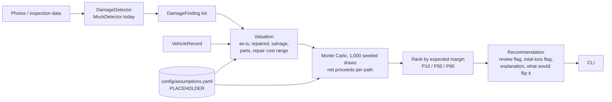

# UnderScope

A decision engine for damaged vehicles. Given damage findings (eventually from ACV inspection
images) plus vehicle data, it estimates net proceeds for each disposition path and recommends
the one with the highest expected margin:

1. Repair, then sell on ACV Auctions
2. Sell as-is on ACV Auctions
3. Sell as salvage on Copart
4. Part out the vehicle

**Status:** development prototype. Every number comes from `config/assumptions.yaml`, all
labeled PLACEHOLDER. ACV and Copart adapters are stubs; there is no network access. Synthetic
data is clearly labeled. Nothing here is real market data.

## Setup

```bash
python3 -m venv .venv
.venv/bin/pip install -e '.[dev]'
make test   # pytest -q
make lint   # ruff
```

## Usage

```bash
.venv/bin/underscope evaluate data/fixtures/dent_600.json          # readable output
.venv/bin/underscope evaluate data/fixtures/total_loss.json --json # machine-readable
.venv/bin/underscope evaluate vehicle.json --labels labels.json    # MockDetector labels per photo ref

.venv/bin/python -m underscope.data          # regenerate data/synthetic/ (500 vehicles, seed 7)
.venv/bin/python -m underscope.backtest      # -> reports/backtest.md (same-model + misspecified)
.venv/bin/python -m underscope.case_studies  # -> reports/case_studies.md
.venv/bin/python -m underscope.sensitivity   # -> reports/sensitivity.md
```

Vehicle JSON fields: `vin, year, make, model, trim, mileage, region, title_status, photo_refs,
undercarriage_damage, engine_audio_abnormal`, `insurance_claim` (adjuster persona; only then can
repair cost past the total-loss threshold brand the title), optional `clean_value_cents`, and optional inline
`findings` (`panel, damage_type, severity 0-1, confidence 0-1`).

## How it works



Notes:
- Money is integer cents in the decision layer.
- `needs_human_review` is set when the top two paths overlap heavily, when finding confidence
  is low, or when the total-loss threshold decides the outcome.
- Results are deterministic for a given seed (`simulation.seed`).
- "What would flip it" finds the repair-cost flip point by search, because repair cost moves
  several paths at once (repair net, as-is price, title brand).
- `config/assumptions.yaml` is schema-checked on load (ordered ranges, 0-100 percents,
  non-negative cents, complete panel/damage/path tables).

## Results (synthetic only)

- `reports/backtest.md`: accuracy, regret vs oracle and review rate against two synthetic
  truths, one drawn from the engine's own model (circular) and one from a misspecified world
  where every placeholder is off by up to 25%. Under misspecification the engine does not
  beat the trivial "always sell as-is" policy on this synthetic mix.
- `reports/sensitivity.md`: which placeholders flip each fixture's recommendation. The dent
  case hinges on the as-is discount multiple and the repaired-value haircut.
- `reports/case_studies.md`: the three fixtures, explained.

The placeholders are deliberately untuned. Data we would need from ACV and Copart:
`docs/DATA_REQUIREMENTS.md`.
