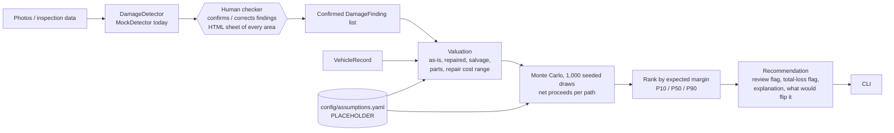

# UnderScope

A decision engine for damaged vehicles. Given damage findings (eventually from ACV inspection
images) plus vehicle data, it estimates net proceeds for each disposition path and recommends
the one with the highest expected margin:

1. Repair, then sell on ACV Auctions
2. Sell as-is on ACV Auctions
3. Sell as salvage on Copart
4. Part out the vehicle

**Status:** development prototype. Every number comes from `config/assumptions.yaml`, all
labeled PLACEHOLDER. ACV and Copart adapters are stubs; there is no network access. Synthetic
data is clearly labeled. Nothing here is real market data.

## Setup

```bash
python3 -m venv .venv
.venv/bin/pip install -e '.[dev]'
make test   # pytest -q
make lint   # ruff
```

## Usage

A human checker confirms the damage findings before any decision (human in the loop).
By default every vehicle is checked; `--review-mode risky` only sends vehicles with risk
signals (low-confidence findings, missing undercarriage/engine inspection, frame or
undercarriage damage, no damage found, or a close/threshold-decided decision).

```bash
# Someone at the terminal: shows every area of the car, writes reviews/<VIN>.html (a diagram
# highlighting all damaged areas), then prompts: a(ccept), + panel type sev, - N, s N sev,
# u yes|no, e yes|no, q(uit).
.venv/bin/underscope evaluate data/fixtures/dent_600.json

# Agent / batch: writes reviews/<VIN>.json + .html and exits 3 (awaiting confirmation).
.venv/bin/underscope evaluate data/fixtures/total_loss.json --no-interactive
.venv/bin/underscope confirm reviews/FIXTOTAL000000001.json --checker NAME \
    [--add frame:dent:0.6] [--remove 2] [--undercarriage yes|no] [--engine-audio yes|no]
.venv/bin/underscope evaluate data/fixtures/total_loss.json --confirmed reviews/FIXTOTAL000000001.json

.venv/bin/underscope evaluate data/fixtures/dent_600.json --review-mode risky   # only risky ones
.venv/bin/underscope evaluate data/fixtures/total_loss.json --json --skip-confirm  # batch/testing
.venv/bin/underscope evaluate vehicle.json --labels labels.json    # MockDetector labels per photo ref

.venv/bin/python -m underscope.data          # regenerate data/synthetic/ (500 vehicles, seed 7)
.venv/bin/python -m underscope.backtest      # -> reports/backtest.md (same-model + misspecified)
.venv/bin/python -m underscope.case_studies  # -> reports/case_studies.md
.venv/bin/python -m underscope.sensitivity   # -> reports/sensitivity.md
```

Vehicle JSON fields: `vin, year, make, model, trim, mileage, region, title_status, photo_refs,
undercarriage_damage, engine_audio_abnormal`, `insurance_claim` (adjuster persona; only then can
repair cost past the total-loss threshold brand the title), optional `clean_value_cents`, and optional inline
`findings` (`panel, damage_type, severity 0-1, confidence 0-1`).

## How it works



Notes:
- Money is integer cents in the decision layer.
- `needs_human_review` is set when another path beats the winner in many simulated draws,
  when finding confidence is low, or when the total-loss threshold decides the outcome.
- Title discounts (clean/rebuilt/salvage) are uncertain ranges drawn together, so repairing a
  salvage car to a rebuilt title shows its real risk.
- Results are deterministic for a given seed (`simulation.seed`).
- "What would flip it" finds the repair-cost flip point by search, because repair cost moves
  several paths at once (repair net, as-is price, title brand).
- `config/assumptions.yaml` is schema-checked on load (ordered ranges, 0-100 percents,
  non-negative cents, complete panel/damage/path tables).

## Results (synthetic only)

- `reports/backtest.md`: accuracy, regret vs oracle and review rate against two synthetic
  truths, one drawn from the engine's own model (circular) and one from a misspecified world
  where every placeholder is off by up to 25%, broken down by damage band and review flag.
  Under misspecification the engine does not beat "always sell as-is" overall; on the cars
  it doesn't flag it only barely does. Its current value is triage.
- `reports/sensitivity.md`: which placeholders flip each fixture's recommendation. The dent
  case hinges on the as-is discount multiple and the repaired-value haircut.
- `reports/case_studies.md`: the three fixtures, explained.

The placeholders are deliberately untuned. Data we would need from ACV and Copart:
`docs/DATA_REQUIREMENTS.md`.
